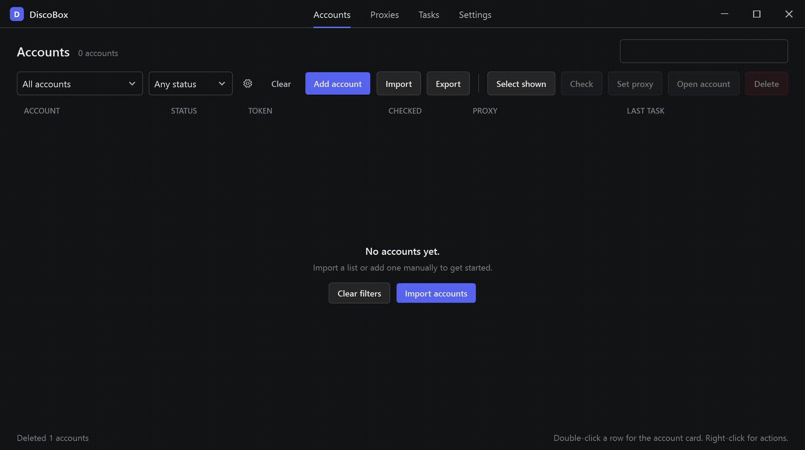

# Discord Account Manager

Windows desktop app that works as a Discord account manager: import token
lists, keep them grouped and tagged, check their status through the account
proxy, and open any account in its own Chrome profile behind a proxy
bridge.

Stack:
- .NET 8
- Discord REST for token checking
- [PuppeteerSharp](https://github.com/hardkoded/puppeteer-sharp) for session token injection
- Chrome user-data and proxy startup flags to specify session folder and local proxy
- [GOST](https://github.com/go-gost/gost) for relaying a local proxy to a remote one with auth

## Features

- Import and export Discord accounts with different formats (token,
  email:password:token, token:proxy and a few more)
- Assign groups and tags, scope filter, mass actions over the current selection
- Assign proxy (manual for each account or random from pool), HTTP and SOCKS5 support
- Status check against Discord REST through the account proxy
- Tasks with a worker pool, live trace and retry of failed runs
- Live account browsing through Chrome with GOST proxy manager as relay
- Per-account Chrome profile stored as a ZIP, opened behind a GOST bridge
  with token injection into the page, one session at a time
- All storage lives in %AppData%\DiscoBox, tokens and proxy creds masked in logs

## Requirements

- Windows 10/11 x64 with .NET 8 (release zips are self-contained)
- Private HTTP/SOCKS5 proxies and Discord tokens 
- Optional if you want account browsing: Google Chrome and GOST

## Install

Get the self-contained zip from the [Releases page](https://github.com/d1scoboy/discord-account-manager/releases),
unpack, run DiscoBox.ProfileManager.exe.

Also you can build from source:

    dotnet build src/DiscoBox.sln
    src\DiscoBox.ProfileManager\bin\Debug\net8.0-windows\DiscoBox.ProfileManager.exe

## First run
0. Install Google Chrome and download latest [GOST](https://github.com/go-gost/gost/releases/) binaries
1. Go to Settings tab and point the Chrome path (the Detect button finds it usualy) and
   gost.exe if you use authenticated proxies.
2. Proxies tab: Add proxy, one line per proxy, lists accepted.
3. Accounts tab: Import, paste your lines, Analyze for the dry-run, then Import.
4. Select accounts and hit Check. Double-click a row for the account card,
   Open in Chrome lives there and in the right-click menu.

## Notes and rough edges

- All actions with accounts must be done using proxy. Im using paid private proxies with authentication and set them manually for each account. Also maybe you can set pool of paid proxies. **Do not use public/free proxies** - account can be deauthorized or banned.
- We need GOST manager to setup local proxy for Chrome and relay local proxy to remote with authentication. Google Chrome doesnt support proxy with auth.
- Discord rotates the token when you log in by hand in the browser. The app
  watches the open session and stores the rotated token back, but the old
  token is dead either way.
- One Chrome session at a time, on purpose: profiles are zip archives and
  two browsers on one archive end badly

## License

MIT
